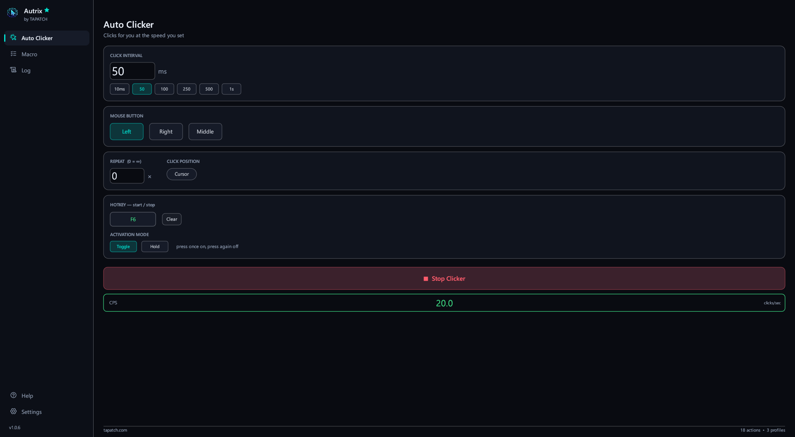
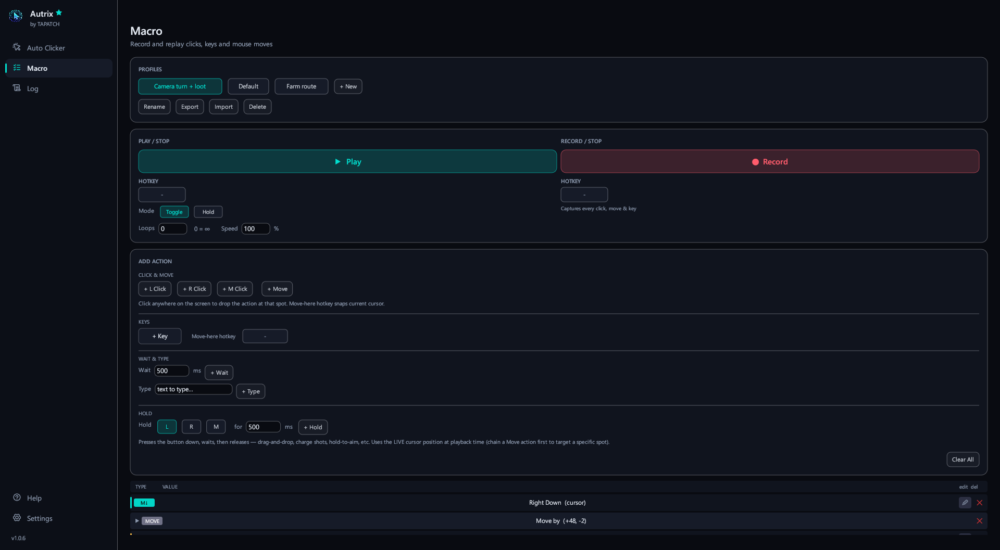
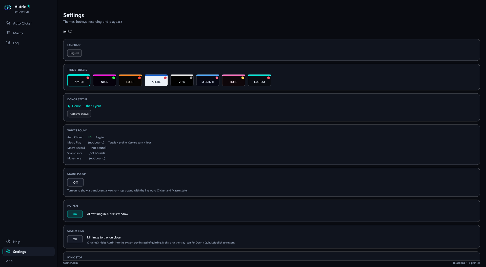
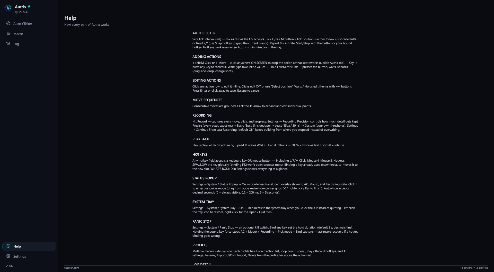

**Autrix 1.0.10** for Windows 10/11 (x64) · Free for personal use

### What's new

- New Click type on the Auto Clicker page: Hold down keeps the mouse button pressed until you stop it, or for a time you set, then lets go and holds again
- Press length for normal clicks: keeps the button down a few milliseconds for games that miss instant clicks (0 = instant, as before)
- Hold down never presses on Autrix itself: it waits until you click into your game, lets go while the cursor is on Autrix, and always lets go when it stops or closes

### Screenshots

 
  

### Video

### Download

**`Autrix-Setup-1.0.10.exe`** is attached below. It is the same file as on [tapatch.com/tools/autrix](https://tapatch.com/tools/autrix/).

### Security

- VirusTotal: **1 / 71** engines flag it · [view report](https://www.virustotal.com/gui/file/258eb8dde978f483b280f32882d822b38544c42be31729dc0460e3f3405a875a/detection)
- SHA-256: `258eb8dde978f483b280f32882d822b38544c42be31729dc0460e3f3405a875a`

*First released on tapatch.com on 2026-11-21.*

---
Free for personal use. Business or commercial use requires a paid license (see [tapatch.com/terms](https://tapatch.com/terms/)).
