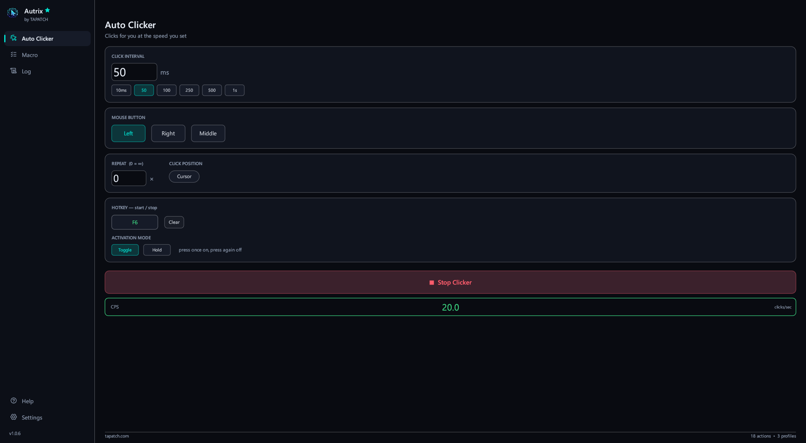
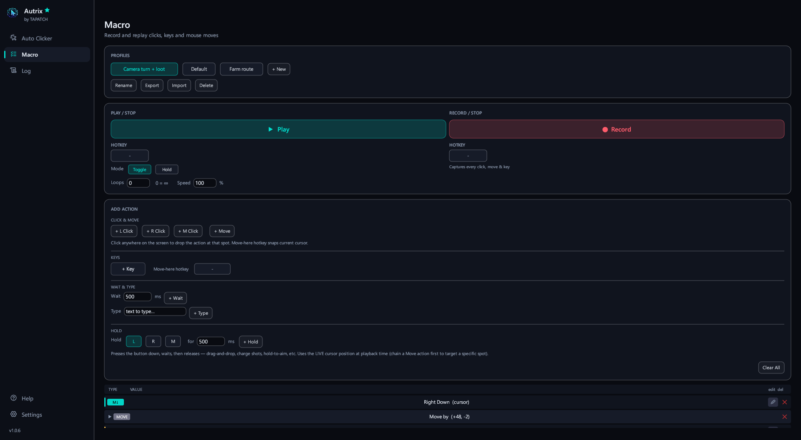
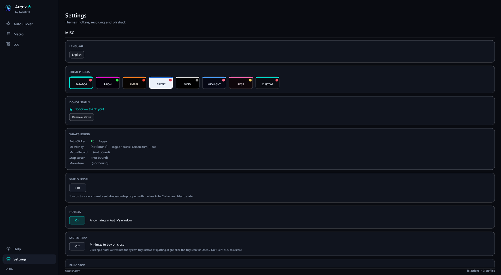
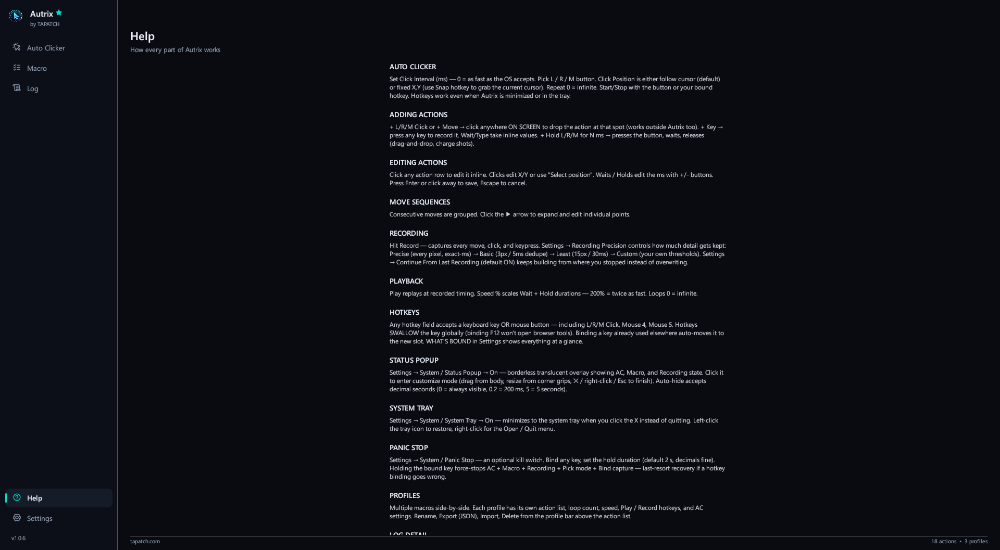

**Autrix 1.0.11** for Windows 10/11 (x64) · Free for personal use

### What's new

- New Start minimized setting: Autrix opens minimized and your hotkeys work right away. With the system tray on, it opens in the tray

### Screenshots

 
  

### Video

### Download

**`Autrix-Setup-1.0.11.exe`** is attached below. It is the same file as on [tapatch.com/tools/autrix](https://tapatch.com/tools/autrix/).

### Security

- VirusTotal: **1 / 71** engines flag it · [view report](https://www.virustotal.com/gui/file/f054f5aa508dca61d2d03030ba9cd0e19f111734f5e3f1cc3b5f313c97232f49/detection)
- SHA-256: `f054f5aa508dca61d2d03030ba9cd0e19f111734f5e3f1cc3b5f313c97232f49`

*First released on tapatch.com on 2026-11-22.*

---
Free for personal use. Business or commercial use requires a paid license (see [tapatch.com/terms](https://tapatch.com/terms/)).
