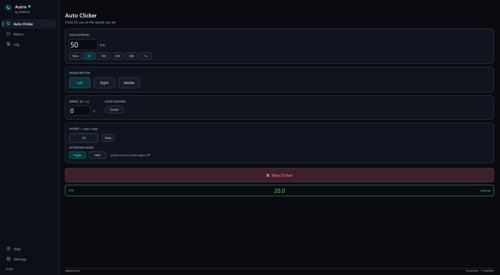
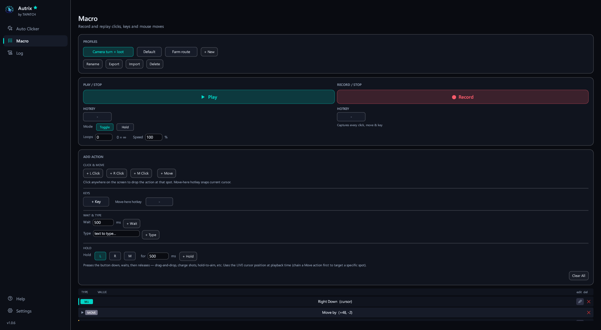
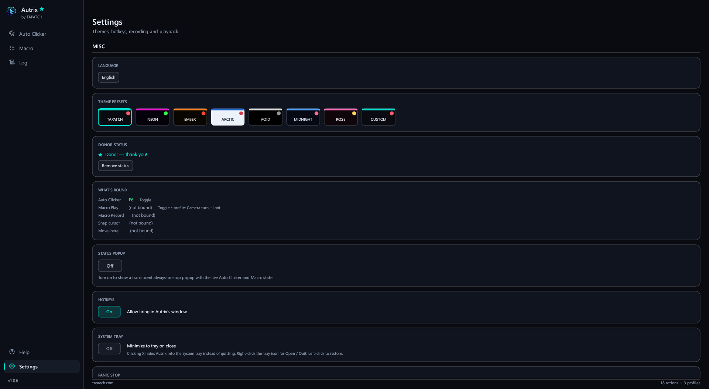
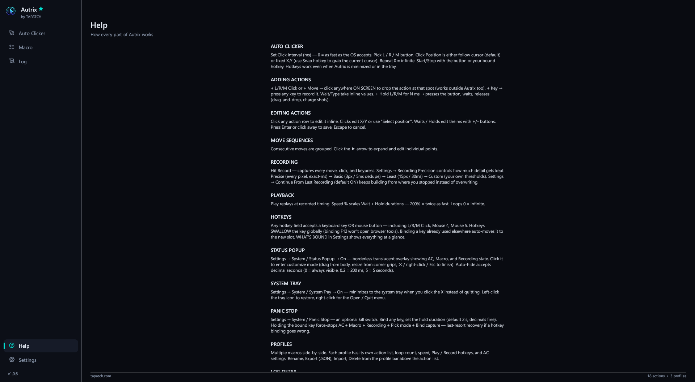

**Autrix 1.0.8** for Windows 10/11 (x64) · Free for personal use

### What's new

- Background pictures and GIFs: add as many as you like in Settings, tick the ones to show (or Select all), and the ticked ones take turns
- Sliders set how strong the picture is and how see-through the panels are; turn it off any time
- Clicks, drags and holds recorded or picked on a monitor left of or above the main one now replay in the right place, not at the cursor (the fixed-position auto clicker too)
- Typing in a text box no longer rewrites the whole settings file on every key
- The installer's license text matches the current Terms, and THIRD-PARTY-NOTICES.txt lists the open-source parts it uses

### Screenshots

 
  

### Download

**`Autrix-Setup-1.0.8.exe`** is attached below. It is the same file as on [tapatch.com/tools/autrix](https://tapatch.com/tools/autrix/).

### Security

- VirusTotal: **1 / 71** engines flag it · [view report](https://www.virustotal.com/gui/file/6904c86c56ed45c58e8a1749e416361536f12ff6413f1f4e5493ec687f793272/detection)
- SHA-256: `6904c86c56ed45c58e8a1749e416361536f12ff6413f1f4e5493ec687f793272`

*First released on tapatch.com on 2026-11-05.*

---
Free for personal use. Business or commercial use requires a paid license (see [tapatch.com/terms](https://tapatch.com/terms/)).
