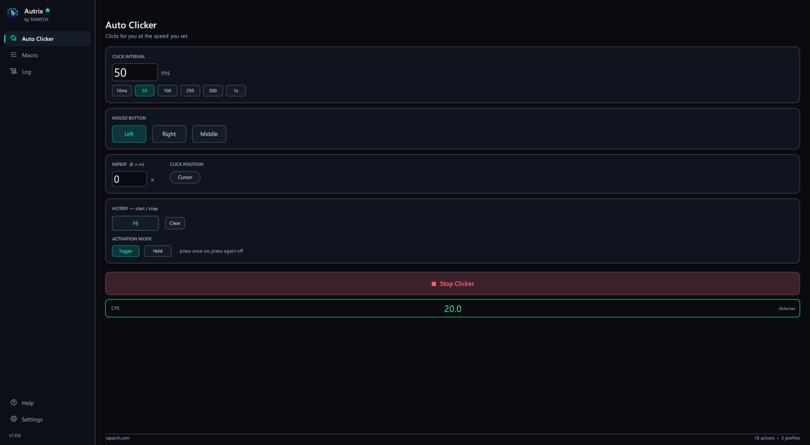
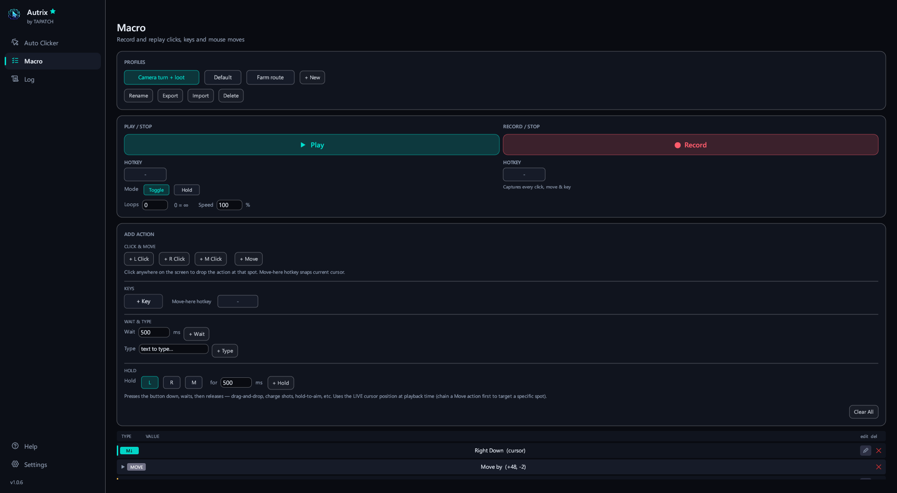
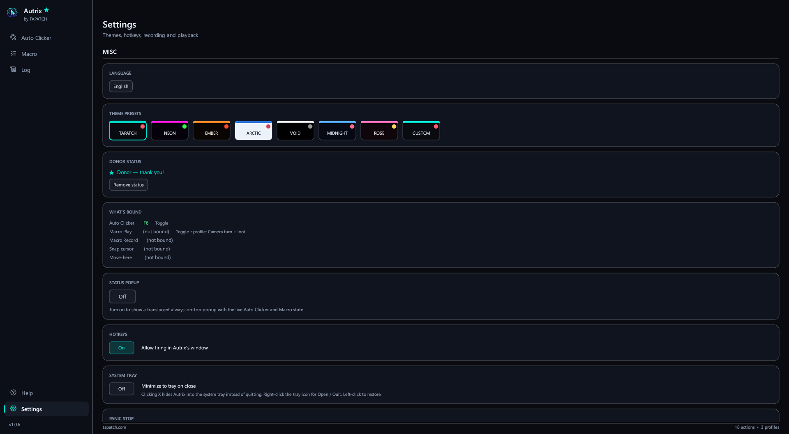
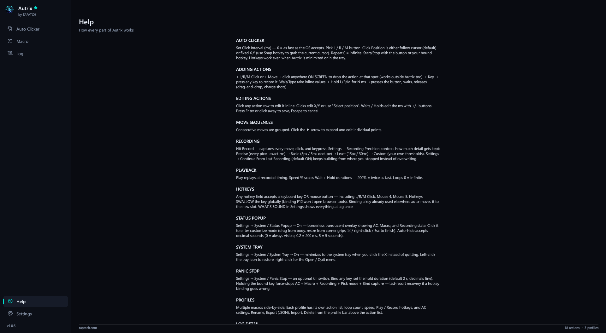

**Autrix 1.0.9** for Windows 10/11 (x64) · Free for personal use

### What's new

- Now opens in virtual machines, Remote Desktop and on PCs without a graphics driver: it switches to Direct3D 12 when OpenGL doesn't work
- If the window still can't open, a message says why instead of the app closing without a word

### Screenshots

 
  

### Download

**`Autrix-Setup-1.0.9.exe`** is attached below. It is the same file as on [tapatch.com/tools/autrix](https://tapatch.com/tools/autrix/).

### Security

- VirusTotal: **1 / 71** engines flag it · [view report](https://www.virustotal.com/gui/file/547300db9e8f5a2d7e6248a871f92002f5f8baa0440f14abf24b4aa48c562a2f/detection)
- SHA-256: `547300db9e8f5a2d7e6248a871f92002f5f8baa0440f14abf24b4aa48c562a2f`

*First released on tapatch.com on 2026-11-11.*

---
Free for personal use. Business or commercial use requires a paid license (see [tapatch.com/terms](https://tapatch.com/terms/)).
