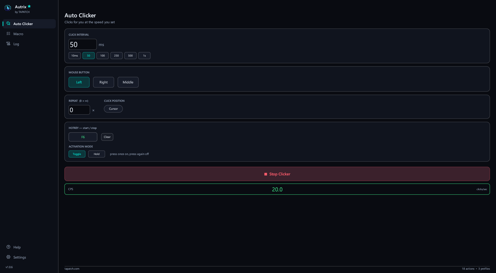
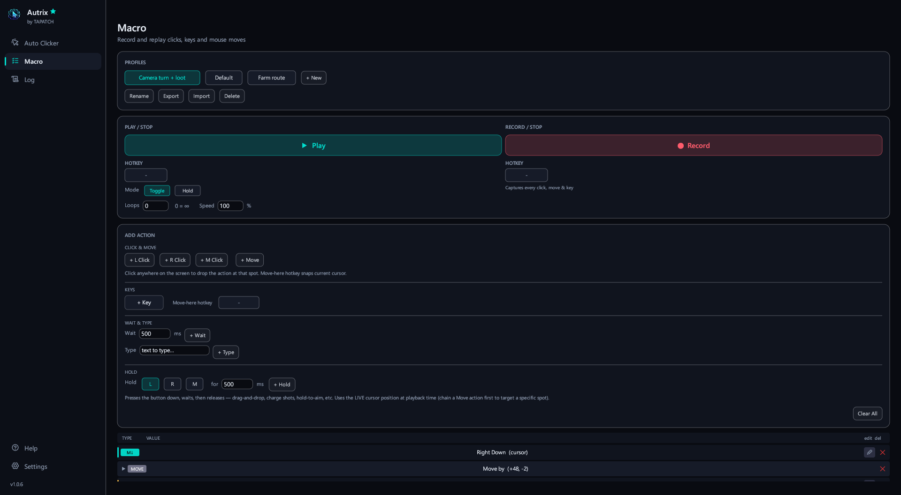
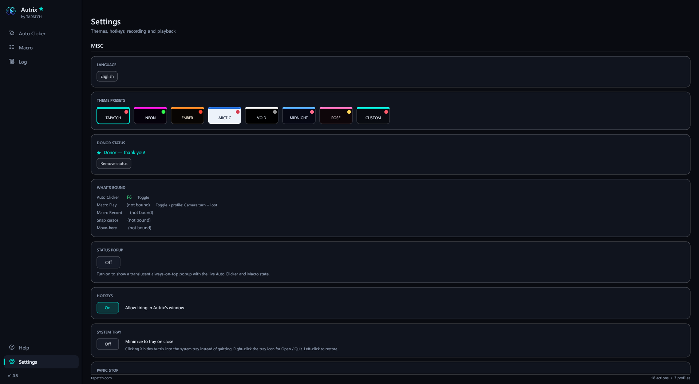
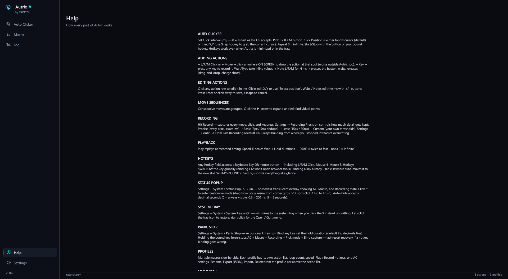

**Autrix 1.1.1** for Windows 10/11 (x64) · Free for personal use

### What's new

- Version 1.1.1. Autrix can click over 1000 times a second, but its version number was still counting 1.0.9, 1.0.10, 1.0.11. We taught it to count
- Nothing else changed: same clicks, same speed, and the Start minimized setting from 1.0.11 is still there

### Screenshots

 
  

### Video

### Download

**`Autrix-Setup-1.1.1.exe`** is attached below. It is the same file as on [tapatch.com/tools/autrix](https://tapatch.com/tools/autrix/).

### Security

- VirusTotal: **1 / 71** engines flag it · [view report](https://www.virustotal.com/gui/file/8057b2223b13e11009fe639b8e8bac55a0908e230e41a2b5a51b212060b2cb7d/detection)
- SHA-256: `8057b2223b13e11009fe639b8e8bac55a0908e230e41a2b5a51b212060b2cb7d`

*First released on tapatch.com on 2026-11-23.*

---
Free for personal use. Business or commercial use requires a paid license (see [tapatch.com/terms](https://tapatch.com/terms/)).
