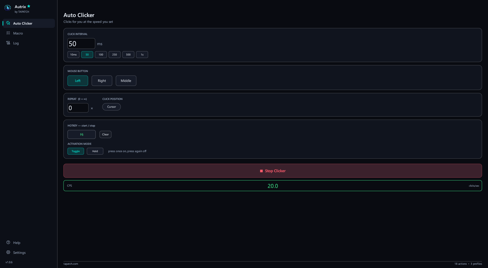
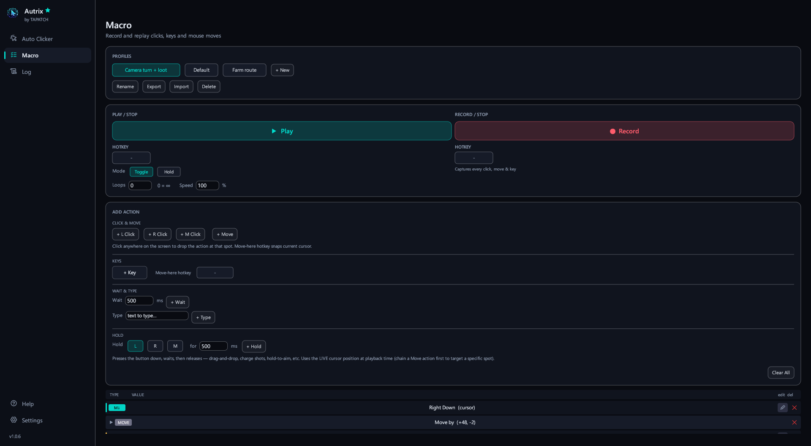
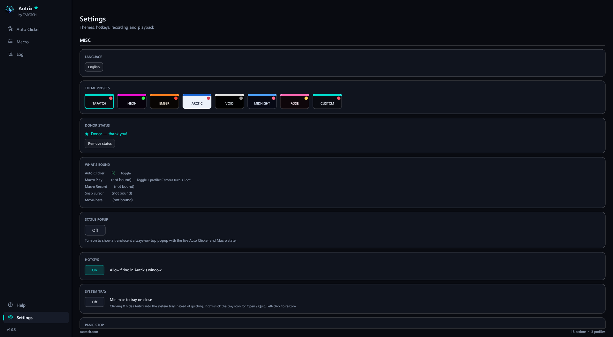
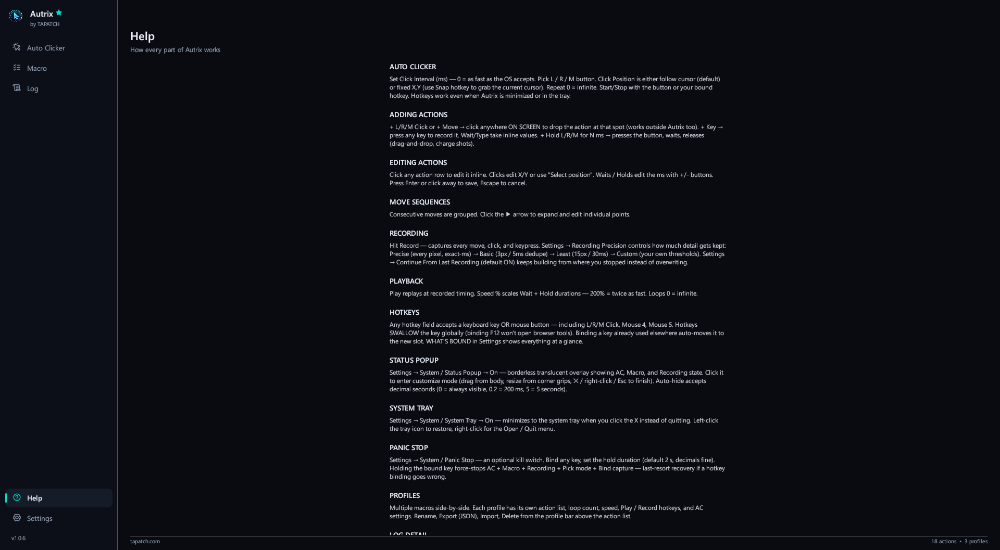

**Autrix 1.1.2** for Windows 10/11 (x64) · Free for personal use

### What's new

- Same font and text sizes as the other TAPATCH apps, so most text is a little bigger
- New UI size in Settings → Size and window: text, buttons and panels get bigger or smaller together (60–200%). Ctrl + and Ctrl − work too, Ctrl 0 goes back to 100%
- The window opens where you left it, on the same screen and at the same size. Or pick Full screen under When the window opens

### Screenshots

 
  

### Video

### Download

**`Autrix-Setup-1.1.2.exe`** is attached below. It is the same file as on [tapatch.com/tools/autrix](https://tapatch.com/tools/autrix/).

### Security

- VirusTotal: **1 / 68** engines flag it · [view report](https://www.virustotal.com/gui/file/8df8207117bb9d2b44fe15b95d8d20f80736ee604d121eae2667d0ad122989ee/detection)
- SHA-256: `8df8207117bb9d2b44fe15b95d8d20f80736ee604d121eae2667d0ad122989ee`

*First released on tapatch.com on 2026-11-27.*

---
Free for personal use. Business or commercial use requires a paid license (see [tapatch.com/terms](https://tapatch.com/terms/)).
